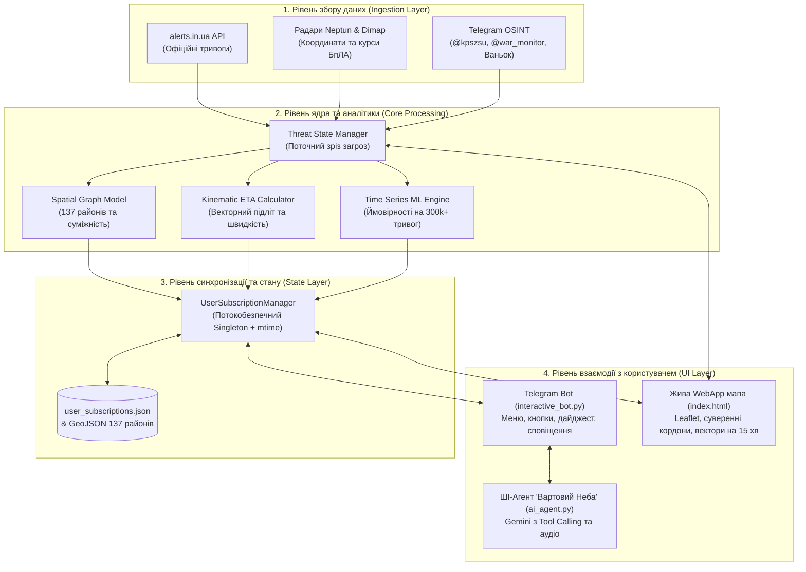
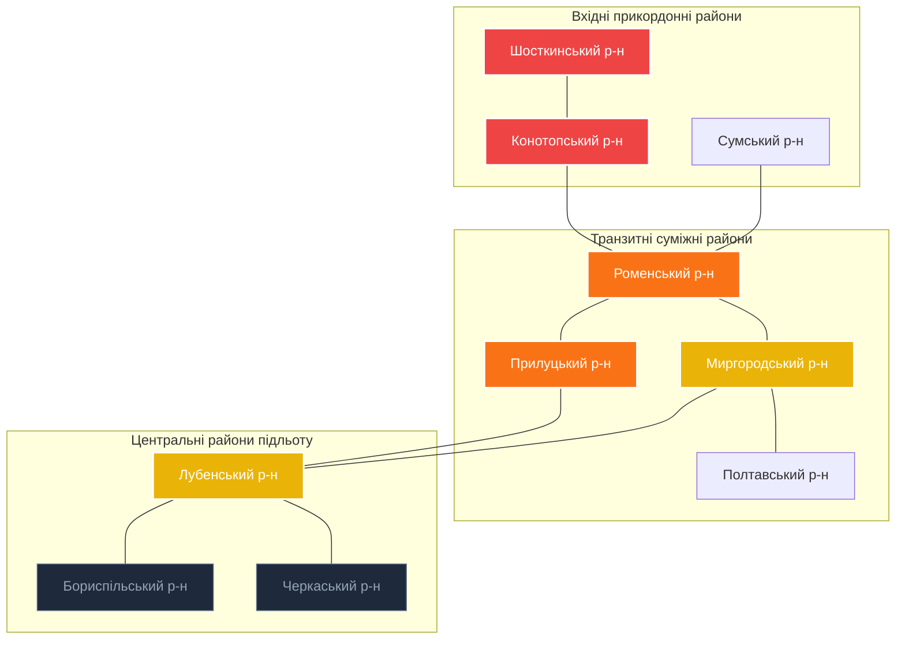
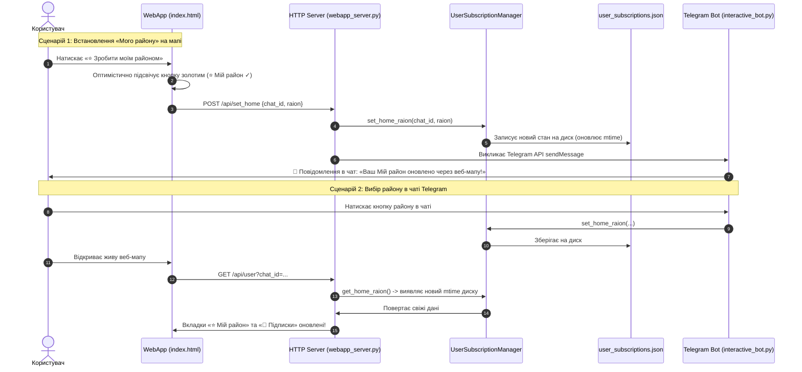

# ФАЙЛ 1: ТЕХНІЧНИЙ ПУТІВНИК ТА АРХІТЕКТУРА СИСТЕМИ
## Інженерний розбір системи «Стоп-Шахед / Вартовий Неба» (для повного розуміння новачку)

> [!NOTE]
> Цей документ є першою частиною комплекту документації. Він призначений для глибокого вивчення технічної складової проєкту: як працюють алгоритми, як влаштована база даних, математика та архітектура коду.

---

## 1. Проблема та концепція проєкту

### Проблема існуючих систем
В Україні сповіщення про повітряні тривоги за замовчуванням відбуваються **на рівні областей**:
* Якщо ворожий дрон залітає на півночі Київської області (біля Чорнобиля), червоною стає **вся Київська область** разом із південними районами (Біла Церква, Миронівка), хоча до них понад 150 км.
* Це призводить до «втоми від тривог» (alert fatigue), зупинки транспорту та економіки в районах, де прямої небезпеки немає, або навпаки — до ігнорування небезпеки.

### Наше вирішення
Проєкт **«Стоп-Шахед / Вартовий Неба»** реалізує **районо-орієнтований моніторинг та прогнозування для всіх 137 районів України**:
1. Координати дронів фіксуються в реальному часі.
2. Прораховується їхній курс, швидкість та **час підльоту (ETA)** до конкретного району.
3. Суміжні райони отримують **«Раннє попередження» (Early Warning)** за просторовим графом.
4. Користувач взаємодіє з системою через **живу інтерактивну мапу Telegram Mini App** або через чат-бота з підтримкою штучного інтелекту Google Gemini.

---

## 2. Глобальна архітектура системи

Система побудована за модульним принципом із чітким розділенням обов'язків (Separation of Concerns):

---

## 3. Просторова топологія: Граф із 137 районів України

### Математичний опис графа
Вся територія України змодельована як просторовий неорієнтований граф:
$$G = (V, E)$$
де:
* **$V$ (Вузли / Вершини):** 137 районів України (згідно з постановою Верховної Ради 2020 року). Для кожного вузла відомі:
  * Точні координати центру мас (центроїд) $(lat_i, lon_i)$ у файлі `data/raion_centroids.json`.
  * Детальний векторний геометрійний контур (MultiPolygon) у `data/ukraine_raions.geojson`.
* **$E$ (Ребра):** Географічне сусідство. Ребро $(u, v) \in E$ існує тоді й тільки тоді, коли район $u$ має спільну сухопутну або водну межу з районом $v$ (файл `data/raion_neighbors.json`).

### Приклад топологічного зв'язку (Коридор руху «Шахедів»):
Погляньте, як пов'язані райони на типовому маршруті прольоту ворожих дронів із північного сходу в центральні області:

### Як граф формує «Раннє попередження» (Early Warning):
1. **Червоний рівень (OFFICIAL):** У Шосткинському районі офіційно включено сирену від ОВА.
2. **Помаранчевий рівень (WARNING):** Радари фіксують ціль, що рухається у бік Конотопа та Ромен.
3. **Жовтий рівень (NEIGHBOR / RADAR):** Лубенський та Миргородський райони автоматично отримують сповіщення: *«Увага! Тривога у суміжних районах, можливий підліт через 25–40 хвилин»*. Люди встигають підготуватися без паніки.

---

## 4. Математичний апарат: Кінематика (ETA) та Machine Learning

### 1. Кінематичний розрахунок часу підльоту (`src/bot/eta_calculator.py`)
Кожна ціль на радарі описується вектором стану:
$$\vec{T} = (\text{lat}_t, \text{lon}_t, \theta, V)$$
де $\theta$ — азимут курсу в градусах ($0^\circ \dots 360^\circ$), $V$ — швидкість (для «Шахеда» зазвичай $\approx 180 \text{ км/год}$).

**Крок 1. Розрахунок дугової відстані за формулою Гаверсинусів (Haversine Formula):**
$$a = \sin^2\left(\frac{\Delta \phi}{2}\right) + \cos(\phi_1)\cos(\phi_2)\sin^2\left(\frac{\Delta \lambda}{2}\right)$$
$$d = 2 R \cdot \operatorname{atan2}\left(\sqrt{a}, \sqrt{1-a}\right)$$
де $R = 6371 \text{ км}$ (радіус Землі), $\phi$ — широта, $\lambda$ — довгота.

**Крок 2. Розрахунок пеленгу на цільовий район ($\beta$):**
$$\beta = \operatorname{atan2}\left(\sin(\Delta \lambda)\cos(\phi_2), \; \cos(\phi_1)\sin(\phi_2) - \sin(\phi_1)\cos(\phi_2)\cos(\Delta \lambda)\right)$$

**Крок 3. Перевірка конуса загрози ($\Delta \alpha$):**
$$\Delta \alpha = |\theta - \beta| \pmod{360^\circ}$$
* Якщо $\Delta \alpha \le 35^\circ$ — дрон рухається прямо на район.
* Якщо $\Delta \alpha > 60^\circ$ — вектор проходить повз район.

**Крок 4. Розрахунок часу підльоту (ETA):**
$$\text{ETA}_{\text{хв}} = \frac{d}{V} \times 60$$

**Крок 5. Вектор проєкції на 15 хвилин вперед:**
На мапі будується штриховий вектор переміщення на 15 хвилин:
$$L_{15\text{m}} = V \times 0.25 \text{ год} \approx 45 \text{ км}$$
$$\text{lat}_{\text{new}} = \text{lat} + \frac{L_{15\text{m}} \cdot \cos(\theta)}{111.0}, \quad \text{lon}_{\text{new}} = \text{lon} + \frac{L_{15\text{m}} \cdot \sin(\theta)}{111.0 \cdot \cos(\text{lat})}$$

### 2. Машинне навчання на часових рядах (Time Series Analysis)
* **Датасет:** `data/alerts_official.csv` містить понад **300 000 офіційних записів тривог** по Україні з 2022 року.
* **Ознаки (Feature Engineering):**
  * `hour_sin`, `hour_cos`, `day_of_week` — циклічні фактори добового ритму атак.
  * `rolling_alerts_count_3h` — лагові змінні активності за останні години.
  * `neighbor_alarm_ratio` — частка сусідніх районів у графі, які зараз перебувають під тривогою.
* **Модель:** Градієнтний бустинг (XGBoost/LightGBM), що видає ймовірність початку або продовження тривоги на горизонти 15, 30, 60 та 120 хвилин.

---

## 5. Telegram WebApp: Жива карта та двостороння синхронізація

Карта є повноцінним веб-застосунком (HTML5/JavaScript/Leaflet), вбудованим у Telegram.

---

## 6. Штучний інтелект «Вартовий Неба» (Google Gemini + Tool Calling)

Бот підтримує розмовний ШІ на базі Google Gemini:

### Технологія Function Calling (Tool Calling)
ШІ-модель під час генерації тексту не вигадує факти, а має право викликати **4 програмні функції (Tools)**:
1. `get_live_alerts_overview(region)` — стан сирен.
2. `get_radar_drones_status()` — онлайн-зріз координат і кількості БпЛА.
3. `analyze_threat_forecast(region, horizon)` — математичний прогноз.
4. `manage_user_tracking(chat_id, action, raion)` — управління підписками.

### Голосові запити (Multimodal Audio)
Користувач може затиснути мікрофон у Telegram і запитати: *«Яка обстановка зараз над Вінницею?»*. Бот приймає голосове аудіо у форматі OGG/Opus, передає через Gemini Multimodal API, розпізнає запит, опитує радари і дає лаконічну відповідь.

---

## 7. Хронологія подоланих труднощів та інженерні рішення

Цей блок наочно демонструє високий інженерний рівень виконаної роботи:

| Проблема | Причина виникнення | Як її було вирішено |
|---|---|---|
| **Зсув маркерів дронів при зумі** | У Leaflet маркери не мали жорсткої прив'язки anchor, а CSS `transition: transform` ламав координаційну сітку при наближенні. | Задали жорстку точку прив'язки `iconAnchor: [12, 12]`, примусово прописали `position: absolute !important` та прибрали конфліктні CSS transitions. |
| **Фантомна тривога в Чернівцях** | Дністровський район Чернівецької обл. вмикався при тривозі у Білгород-Дністровському (Одеса), бо перевірка робилася за входженням підрядка: `"дністровський" in "білгород-дністровський"`. | Замінили `in` на суворе точне порівняння нормалізованих назв (`==`) та словник канонічних синонімів районів. |
| **Розсинхронізація WebApp і бота** | 1. Менеджер підписок тримав стан лише в пам'яті. 2. Кнопка у WebApp викликала `tg.close()` одразу, обриваючи асинхронний `fetch`. 3. У посиланнях WebApp не передавався `chat_id`. | Впровадили Singleton із перевіркою `mtime` диску, прибрали передчасний `tg.close()`, додали автоматичну передачу `?chat_id=` у всі кнопки та сповіщення в чат. |
| **Каша з написів над картою** | Кожен дрон мав великий чорний бейдж з текстом, і при масованій атаці (20–40 цілей) карта перетворювалася на суцільний чорний квадрат із літер. | Перейшли на мінімалістичні тактичні силуети літачків (Шахедів), орієнтованих за курсом, а повну інформаційну картку зробили спливаючою лише по кліку. |
| **Помилка 503 UNAVAILABLE від Gemini** | Сервери Google періодично перевантажувалися через глобальні сплески запитів до моделі `gemini-2.5-flash`. | Створили автоматичний каскад резервного перемикання (Fallback): бот непомітно для користувача пробує `gemini-2.0-flash` та `gemini-1.5-flash`. |
| **Вихід за межі карти** | Користувач міг випадково скролити мапу у відкрите Чорне море або вглиб сусідніх країн. | Обмежили перегляд суворими суверенними координатами України `[44.38..52.38 N, 22.10..40.25 E]` із `maxBoundsViscosity: 1.0`. |
